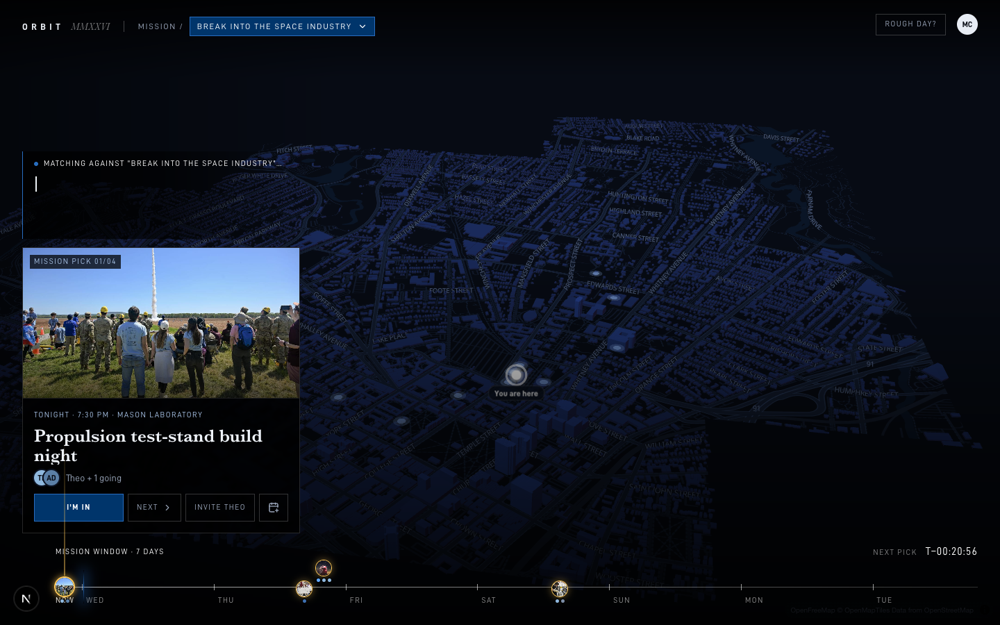
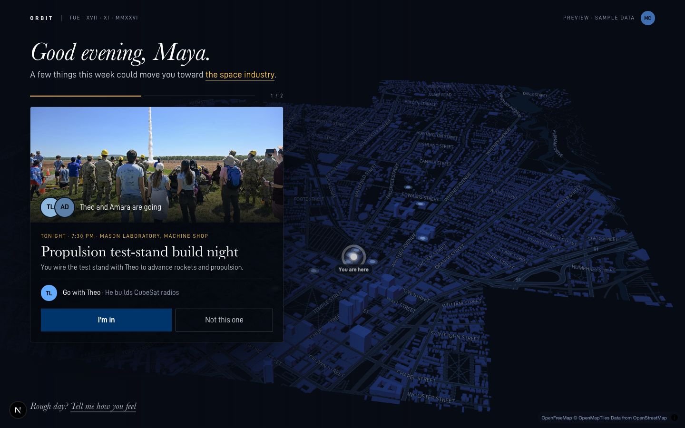
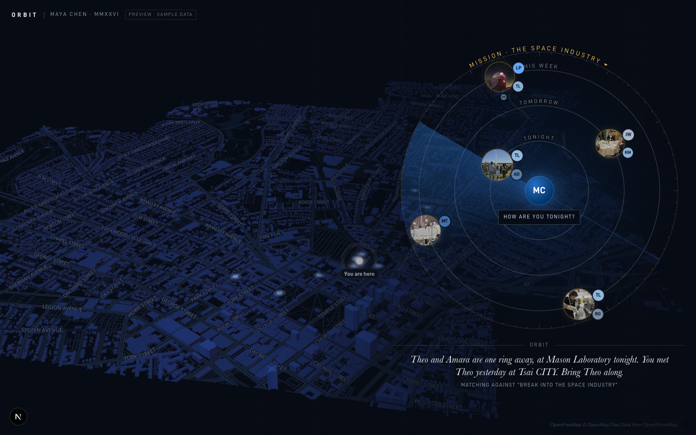

# Interface redesign: three proposals (2026-11-17, evening)

## DECISION (2026-11-17, evening): design C, rebuilt on a real design system

The owner picked **C · Your Orbit**, but said the hand-written styling was not beautiful: "use a real design system to code it, to get a really beautiful design". So C was rebuilt and is now the main interface at `/`.

- **Design system: shadcn/ui** (Radix primitives, preset `radix-lyra`: square corners) + **Motion** (`motion/react`) for every animation. Components live in `components/system/` (button, card, avatar, badge, dropdown-menu, popover, tooltip, dialog, textarea, separator, scroll-area). Config: `components.json` (alias `ui` → `@/components/system`, because `components/ui/` holds the old app pieces and macOS file names are case-insensitive).
- **Theme tokens** in `app/globals.css` (`:root`): `--primary` = Yale Blue `#00356B`, `--ring` = `#286DC0`, dark surfaces, `--radius` 2 px. The `<html>` has the `dark` class. Gold `#FFC857` (week picks) and sky `#63AAFF` (tonight) stay accents only.
- **The interface**: `components/orbit/` — `Orbit.tsx` (root, state, layout, Orbit's voice), `Masthead.tsx` (wordmark, Roman date, mission dropdown, sample badge, avatar), `OrbitDiagram.tsx` (SVG rings drawn with Motion, photo planets with friend moons, tooltips, radar while thinking), `EventCard.tsx` (the proposal as a Card with I'm in / Invite / calendar), `InviteDialog.tsx` (Dialog), `Person.tsx` (Avatar with initials), `model.ts` (rings, geometry, voice line, labels, Roman date).
- `app/page.tsx` mounts the map inside an `isolate` wrapper so the map's marker layers stay under the interface and its menus (Radix portals use z-50).
- Screenshots: `docs/designs/orbit-thinking.png` (Orbit reading the week). Verified in a real browser at 1440×900 and 1280×720: proposal card, mood popover → tonight mode with "Why it works" and the safety line, invite dialog, no console error.

**Rules for any further UI work:** build only from `components/system/*` and the tokens; never hand-roll a button, card, menu or dialog with raw Tailwind; never add a font (see Typefaces below). To add a component: `pnpm dlx shadcn@latest add <name>`, answer **no** to overwrite prompts, then replace `from "cn"` with `from "@/lib/utils"` in the new file (the CLI writes a wrong import).

Designs A and B (`/designs/a`, `/designs/b`) were **not chosen**; they are kept only as reference and can be deleted. `/designs/c` now shows the same page as `/`. `components/ui/Shell.tsx` and the old panels are no longer used by `/`; `components/ui/util.ts`, `Avatar.tsx` and `lib/links.ts` are still used.

## History: the three proposals

The owner rejected the first interface (`components/ui/Shell.tsx`). Three interfaces were built as separate pages so he could pick one.

## Why (the owner's words, translated)

- "There is a big chatbot bar, and that is exactly what we must not have. It has to **propose things to us**, organic, **like a human relationship**."
- "The side panels, 'connected', Canvas, all the connections: nobody cares." Remove the course list, the profile panel, counts like "12 events this week", the mission log list.
- "Concrete, visual, simple, but also emotional." Futuristic, a bit cyberpunk (SpaceX, X, Cursor).
- "Like a **collaboration between Yale, SpaceX and Tesla**, with **Yale's colors**, futuristic, but something that shows it is **cultural**."

The full brief every proposal follows (rules, colors, fonts, store usage) is in `components/designs/BRIEF.md`. Read it before touching any design.

## Where everything is

| What | Path / URL |
|---|---|
| Index of the three | http://localhost:3417/designs (`app/designs/page.tsx`) |
| Shared auto-start (Orbit proposes on load, no input) | `components/designs/useAutoStart.ts` |
| A · Mission Control | http://localhost:3417/designs/a · `app/designs/a/page.tsx` · `components/designs/a/` |
| B · The Briefing | http://localhost:3417/designs/b · `app/designs/b/page.tsx` · `components/designs/b/` |
| C · Your Orbit | http://localhost:3417/designs/c · `app/designs/c/page.tsx` · `components/designs/c/` |
| Screenshots (1440×900, `?demo=1`) | `docs/designs/a.png`, `b.png`, `c.png` |

Each page mounts the same 3D map (`components/map/CampusMap.tsx`) and one `Root` component. All three use the same store (`lib/store.ts`) and engine; only the overlay differs. Add `?demo=1` to use the recorded fallbacks, no API call.

**Typefaces (owner, 2026-11-17: "copy the fonts of Yale or Tesla or other sites, don't use your own fonts").** No invented or generic font. Sans, labels and telemetry = **D-DIN, the typeface spacex.com serves** (open licence SIL OFL 1.1, files and licence in `app/fonts/d-din/`, loaded in `app/layout.tsx`, exposed as `font-sans` and `font-mono`). Serif for Orbit's voice and titles = **the exact font stack of yale.edu** (`font-serif`: `yale, YaleNew, Baskerville, Times New Roman…`, defined in `app/globals.css`). The Yale typeface itself (Carter & Cone, Yale-community licence, no redistribution), Mallory (yale.edu's sans, commercial) and Universal Sans (tesla.com, proprietary) may **not** be copied into a public site; do not download or ship their files. Never reintroduce Geist, Cormorant or any Google font.

Common to all three: no text field anywhere; Orbit runs the week plan by itself on load; the goal is a tap that opens the 4 presets; mood ("Rough day?") is a small secondary entry that runs tonight mode with the mechanism line, citation and safety line; real photo, when/where, one human sentence, friends' faces, "Go with", I'm in, Invite, calendar. Yale Blue `#00356B` leads, gold only for pick lights, light blue for tonight, Yale's serif stack for Orbit's voice and titles, D-DIN for everything else.

### A · Mission Control

SpaceX launch telemetry. Top bar `ORBIT MMXXVI · MISSION / BREAK INTO THE SPACE INDUSTRY ▾` (Yale Blue chip). Orbit's sentence types itself in serif italic, with the focused pick as a sharp card under it (I'M IN / NEXT / INVITE THEO / calendar). At the bottom, a 7-day mission timeline with gold photo nodes and a live `T–` countdown to the next pick. `ROUGH DAY?` switches to a light-blue 48 h timeline. Files: `Root.tsx`, `Timeline.tsx`, `parts.tsx`.
Known: picks close in time stack two rows high near NOW.

### B · The Briefing

Orbit as a friend proposing **one thing at a time**. Big serif greeting "Good evening, Maya.", the goal words tappable, a Roman-numeral date in the masthead. One large card (photo with friends' faces on it, serif title, why, "Go with Theo"), two choices only: `I'm in` / `Not this one`, progress segments 1/N. After the last card, "Your week" summary tiles with calendar links. "Rough day? Tell me how you feel" at the bottom-left. Files: `Root.tsx`, `ProposalCard.tsx`, `parts.tsx`.
Known: at 1280×720 the tonight card nearly touches the bottom edge.

### C · Your Orbit (chosen, now rebuilt in `components/orbit/`)

The most visual. On the right half, an SVG orbital diagram: Maya at the center, rings TONIGHT / TOMORROW / THIS WEEK, each pick a round photo planet with friend moons drifting slowly; hover brightens, click opens a detail panel and flies the map there. The mission as an arc label; `HOW ARE YOU TONIGHT?` pill near the center for tonight mode. Files: `Root.tsx`, `Detail.tsx`, `orbit.ts`.
Known: the detail card covers the screen center (hides beams there); the overlay uses z-index 10000 because map markers use ~5000.

## What to do once the owner picks

1. Make the chosen `Root` the main interface: in `app/page.tsx` replace the `Shell` overlay with the chosen `components/designs/<x>/Root` (keep `useAutoStart`).
2. Delete the two other design folders and pages, and the old `components/ui/` pieces nobody imports any more (check with `grep -r` first; `Avatar.tsx`, `InviteDialog.tsx`, `util.ts` and `lib/links.ts` are reused by the designs).
3. Fix the "Known" items of the chosen design, run `./node_modules/.bin/tsc --noEmit` and `./node_modules/.bin/eslint .`, check at 1280×720 and 1440×900, retake its screenshot.
4. Then continue the START HERE list in `PLAN.md` (data, fallbacks, prod build, deploy). Step 3 there (marker click opens the card in the right rail) now means: a marker click must focus that pick in the chosen design.

## UPDATE 2026-11-17, ~19:30 — Tesla-screen look (owner's latest instructions, in progress)

Owner's words (translated): "it's a UI like this that we need" (photo of the Tesla Model 3 in-car screen: light grey, white rounded panels, pill segmented controls, round icon buttons, one bright blue active pill, grey tiles with icon + uppercase label, bottom dock); "the font is not right, take the same font as Tesla or Yale (Tesla ideally)"; "it is very important to navigate the map very easily, go anywhere, rotate it, flatten it, with exactly the same gestures as Google Maps".

Done (committed 2026-11-17):
- Design system switched to shadcn preset **radix-maia** (rounded, pills); light tokens in `app/globals.css` (bg #f4f4f4, ink #171A20, primary #286DC0, radius 0.75rem); `<html>` no longer `dark`.
- Map light (OpenFreeMap `positron` restyled in `components/map/scene.ts`): week beams Yale blue #286DC0, tonight beams amber #E8932A; markers recolored in `markers.ts`; map padding left 440 / right 640.
- New layout in `components/orbit/`: `Bars.tsx` (status bar + dock with mission ‹ › arrows like Tesla climate), `Orbit.tsx` (left column: serif greeting, orbit diagram, Orbit's voice card; right: sheet), `Sheet.tsx` (menu For you / Tonight / Friends / Mission), `Proposal.tsx` (proposal + Tile), `OrbitDiagram.tsx` recolored light. `EventCard.tsx` and `Masthead.tsx` removed.
- Verified 1440×900 and 1280×720: For you, Tonight (mood → amber), Friends (Add), Mission.

Font: Tesla's font is **Universal Sans** (Family Type). Its web use needs a paid webfont licence (trial forbids websites). Copying the files from tesla.com is not allowed. Until the owner buys the licence, the CSS asks for "Universal Sans Display" / "Universal Sans Text" first (used if installed or licensed later), then the Apple system font, which is the closest free match.

Next: Google-Maps-like map navigation (drag pan, scroll/pinch zoom, right-drag or ctrl-drag rotate and tilt, two-finger rotate/tilt, compass/zoom control, idle spin stops at first touch).

Map navigation (done 2026-11-17, `components/map/scene.ts`): Google-Maps gestures, all MapLibre handlers on: drag = pan (also when the drag starts on a marker; a marker only selects on a click that did not move), wheel / trackpad pinch / double-click = zoom on the cursor, right-drag or Ctrl-drag = rotate + tilt, two fingers = pinch, twist, tilt, arrow keys and +/-. Pitch 0-85, zoom 3-20. Compass + zoom buttons bottom-left of the visible map (click the compass to face north and flatten). Idle spin stops at the first input.

Font decision (2026-11-17, owner: "no, take another one that looks like it"): no Tesla licence. The UI font is **Geist** (SIL OFL, loaded by next/font/google in `app/layout.tsx` as `--font-geist`), the free typeface closest to Universal Sans. Serif stays the yale.edu stack. Screenshot: `docs/designs/c-tesla.png`.

No italics (owner, 2026-11-17: "all the italics are not nice"): never use `italic` in the app UI. Serif text (greeting, Orbit voice) is upright.

No serif either (owner, 2026-11-17, pointing at the greeting and the Orbit card: "these texts, when I say italic, remove them"): every text uses Geist. `--font-serif` now points to the sans stack.

Merged 2026-11-17 with the team repo github.com/Himalaya-Gir/hackathon-yale-2026 (remote `himalaya`, fetch only, push disabled): their data, engine, onboarding, /pitch and map navigation (search, back to campus, zoom, compass, scale; restyled light in navigation.ts) + our Tesla interface. Their hover tooltips listened on a missing layer `orbit-dots`, now `all-events`.
